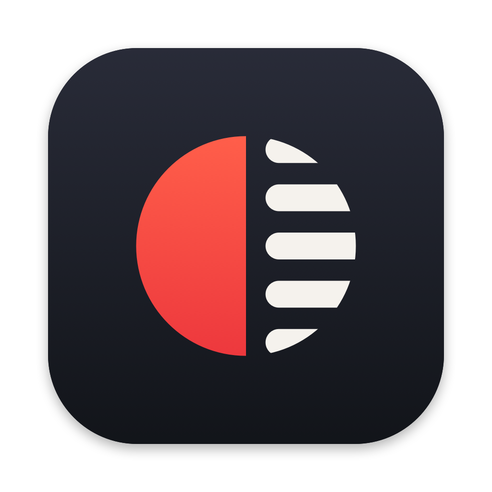
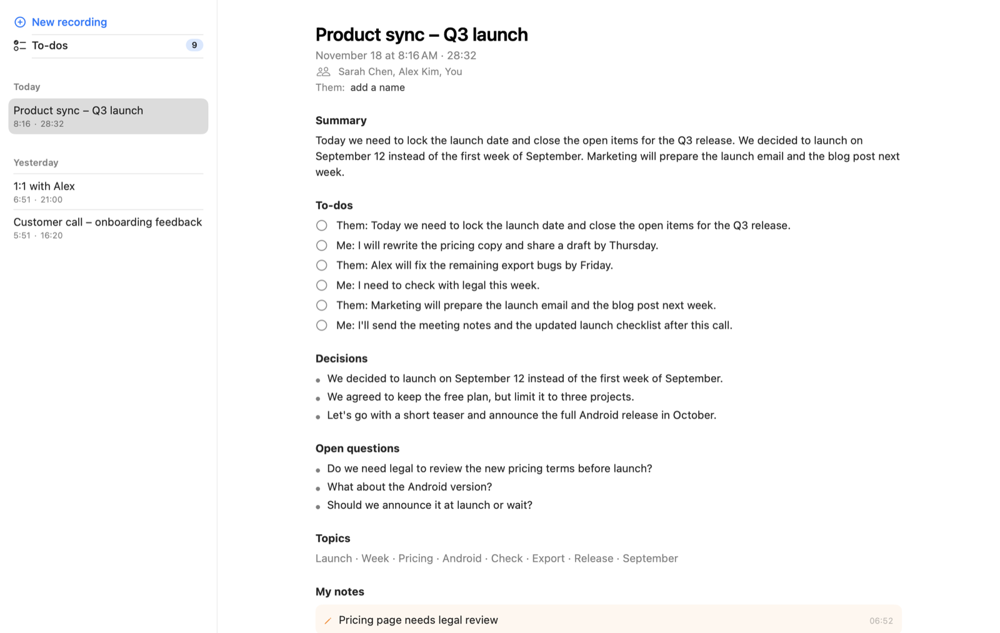
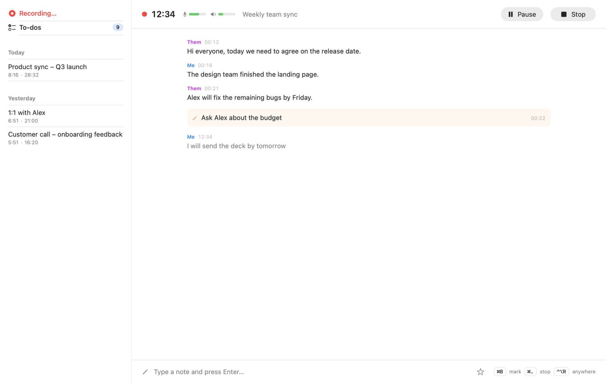
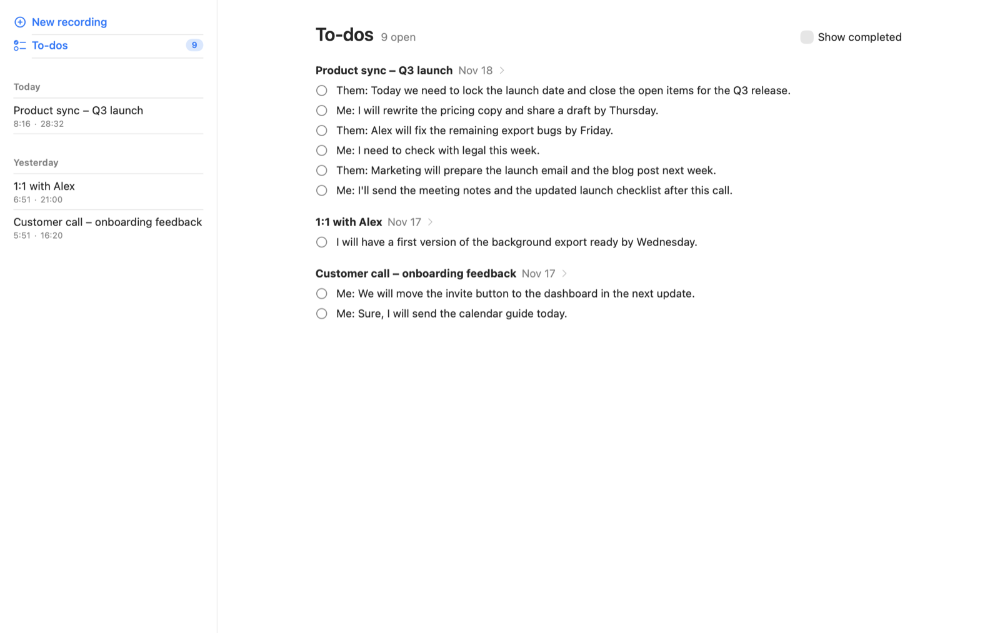

<div align="center">



# Offrecord

**Your meetings, off the record.** Record, transcribe and summarize meetings privately, on your Mac.

An open-source, local-first meeting recorder and AI note taker for macOS.
Captures your calls and meetings, transcribes them on-device and turns them into
summaries, decisions and to-dos. Your audio never leaves your Mac.

[](https://github.com/RamazanBakir/offrecord/releases)


**[Website](https://ramazanbakir.github.io/offrecord/)** · [Install](#installation) · [Release notes](https://github.com/RamazanBakir/offrecord/releases) · [Changelog](CHANGELOG.md)



</div>

## Why Offrecord?

Most AI meeting assistants upload your conversations to someone else's servers,
send a bot into your calls and charge a monthly fee. Offrecord takes the opposite
approach:

- **On-device.** Recording, transcription and note generation run on your Mac
  with Apple's own frameworks. No account, no server, no telemetry.
- **Works with any app.** Zoom, Google Meet, Microsoft Teams, Slack huddles,
  WhatsApp, FaceTime, phone calls through your Mac, or an in-person conversation.
  Nobody else has to install anything or let a bot join.
- **Free and open source.** MIT licensed, zero third-party dependencies, easy to
  audit and build yourself.

It is a private, open-source alternative to cloud note takers such as Otter.ai,
Fireflies, Fathom or Granola.

## Features

- 🎙️ **One-click recording** of your microphone and the other side of the call
  (system audio), with optional screen recording of a whole display or a single
  window.
- ✍️ **Live transcription on-device** with speaker labels (*Me* / *Them*) and
  dozens of languages, including Turkish. Detects the language automatically
  (your system language or English), separately for you and the other side.
- 🧠 **Automatic meeting notes**: summary, key topics, decisions, action items and
  open questions. Uses Apple Intelligence when available, local rules otherwise.
- ✅ **To-do list** that collects action items from every recording, with checkboxes.
- 📞 **Call detection**: offers to record when a call starts in another app and
  stops by itself when the call ends.
- 🔊 **Clear audio**: voice processing during calls and automatic level balancing
  afterwards, so a quiet microphone is still easy to hear.
- 📅 **Calendar aware**: names the recording after the current event and lists
  its attendees.
- 🛟 **Crash-safe**: if the app or your Mac stops mid-meeting, the recording is
  recovered on the next launch.
- 🔍 **Full-text search** across titles, notes and transcripts.
- ⌨️ **Global shortcut** (⌃⌥R), a menu bar icon and a floating recording bar that
  stays on top of every app.
- 📄 **Plain files**: every meeting is a folder with `audio.m4a`, a Markdown
  `notes.md` and JSON. Share it, sync it, or open it in any editor.
- 🌍 **English and Turkish interface**, switchable in Settings.

<table>
  <tr>
    <td></td>
    <td></td>
  </tr>
  <tr>
    <td align="center">Live transcript and notes while recording</td>
    <td align="center">Action items from every meeting</td>
  </tr>
</table>

<p align="center">
  <br>
  <em>The floating recording bar stays on top of your call window.</em>
</p>

## How it compares

| | Offrecord | Typical cloud AI note taker |
|---|---|---|
| Where audio is processed | On your Mac | Vendor's servers |
| Bot joins your meeting | No | Often |
| Works with any call app or in person | Yes | Usually specific platforms |
| Account required | No | Yes |
| Price | Free, open source | Monthly subscription |
| Your files | Plain audio, Markdown and JSON in a folder you choose | Inside the vendor's app |

## Requirements

- macOS 26 (Tahoe) or later
- Apple silicon Mac (M1 or later)
- Xcode 26 or its Command Line Tools (`xcode-select --install`)

## Installation

There are two ways to install Offrecord. Both need macOS 26 on Apple silicon.

### Option 1: Download the app

1. Download `Offrecord-X.Y.Z.zip` from the [latest release](https://github.com/RamazanBakir/offrecord/releases/latest),
   unzip it and move **Offrecord** to your Applications folder.
2. Open it. Offrecord isn't notarized by Apple yet, so macOS blocks the first launch.
   Open **System Settings › Privacy & Security**, scroll down and click **Open Anyway**.

macOS treats every downloaded version as a new app, so after an update it may ask for
Microphone and Screen & System Audio Recording permission again. Building from source
avoids that.

### Option 2: Build from source (recommended)

You build the app on your own Mac in about a minute. No Apple Developer account is
needed and nothing is downloaded during the build.

```sh
git clone https://github.com/RamazanBakir/offrecord.git
cd offrecord
./scripts/install.sh
```

The install script:

1. checks your macOS version, chip and developer tools,
2. creates a self-signed **local** code-signing certificate in your login keychain
   (it never leaves your Mac and lets macOS remember permissions across updates),
3. builds the app with Apple's toolchain, copies it to `~/Applications` and opens it.

Because you build the app yourself, Gatekeeper shows no "unidentified developer" warning,
and permissions are kept across updates.

| Task | Command |
|---|---|
| Update | `git pull && ./scripts/install.sh` |
| Uninstall | `./scripts/uninstall.sh` (add `--purge` to remove the certificate too) |
| Install a specific version | `git checkout v0.1.0 && ./scripts/install.sh` |
| Build only | `./scripts/build-app.sh` → `build/Offrecord.app` |

Your recordings in `~/Documents/Offrecord` are never touched by uninstalling.

### Updates

Offrecord checks GitHub for a new release twice a day and shows a banner in the main
window when one is available. The check is a single request to the GitHub API with no
personal data; turn it off or check manually in Settings › About.

The installed version is shown in Settings › About. See [CHANGELOG.md](CHANGELOG.md)
for what changed in each release.

### Permissions

On the first recording macOS asks for **Microphone**, **Speech Recognition** and
**Screen & System Audio Recording** (needed to capture the other side of a call).
Calendar access is optional. macOS ties these grants to the app's signature; when the
signature changes, `install.sh` clears the old grants so macOS asks again. If recording
still fails with a permission error although System Settings shows it allowed, macOS kept
a stale grant: run `./scripts/uninstall.sh && ./scripts/install.sh` and allow the
permissions again.

## Usage

1. Pick **Online meeting / call** (your mic + system audio) or **In person** (mic only).
   Tick **Also record the screen** if you want a video. When you start, macOS asks
   which display or window to record; next to the checkbox you can choose to reuse the
   last choice instead.
2. Press the record button, ⌃⌥R anywhere, or click the menu bar icon.
3. Type notes or press ⌘B to mark an important moment while you talk.
4. Press **Stop**. The summary, decisions and to-dos are ready a few seconds later.

Pausing pauses the screen video too, and the video uses the same echo-cancelled
audio as `audio.m4a`. To record another display or window mid-meeting, press
**Change screen** (also in the File menu); the video continues with the new choice,
fitted into the same frame, and the audio is not interrupted.

You can also transcribe an existing audio or video file with ⌘O.

| Shortcut | Action |
|---|---|
| ⌃⌥R | Start / stop recording from anywhere |
| ⌘. | Stop recording |
| ⌘B | Mark important moment |
| ⇧⌘P | Pause / resume |
| ↩ | Add note (while recording) |
| ⌘O | Transcribe an audio / video file |
| ⌘⌫ | Delete selected recording |
| ⌘, | Settings |

## How it works

| Step | Technology |
|---|---|
| Capture | `AVAudioEngine` with Apple voice processing for the microphone, `ScreenCaptureKit` for system audio and screen |
| Storage while recording | 24 kHz PCM CAF files that stay readable even after a crash |
| Transcription | `SpeechAnalyzer` (`SpeechTranscriber`, or `DictationTranscriber` for languages it lacks, such as Turkish); mic and system audio are transcribed separately for speaker labels |
| Language detection | Each candidate language's model transcribes the first sentences; the one with clearly higher word confidence is kept (wrong languages score about 0.1, the right one about 0.9) |
| Echo removal | On speakers the call leaks into the microphone; microphone lines that repeat the other side at the same moment are dropped |
| Sentences | Pause- and grammar-based sentence restoration for languages without punctuation output |
| Notes | `FoundationModels` (Apple Intelligence) when enabled and the language is supported; otherwise a rule-based extractor (`NaturalLanguage`) |
| Audio | Per-utterance level balancing, 80 Hz high-pass and a peak limiter, exported to AAC |
| Call detection | Core Audio process objects show which app is using the microphone |

Each meeting is saved to `~/Documents/Offrecord/<date> <title>/`
(the folder can be changed in Settings):

```
audio.m4a          mixed, level-balanced audio
screen.mov         screen recording with the same audio (optional)
notes.md           summary, decisions, action items, questions, your notes, transcript
notes.json         structured notes
transcript.json    timestamped transcript with speakers
manual-notes.json  notes you typed during the meeting
meta.json          title, date, duration, attendees
```

## Privacy

- Audio, transcripts and notes are stored only in the folder you choose.
- Transcription and note generation run on-device. Your audio, transcripts and
  notes are never sent anywhere.
- The only network request the app makes is the update check (the latest version
  number from the GitHub API), which you can turn off in Settings › About. macOS may
  download Apple's speech model for a language the first time you use it.
- No analytics, no crash reporting, no account.

## Recording consent

Laws about recording conversations differ between countries and states. Many
require the consent of everyone in the conversation. Tell people when you record
and follow the rules that apply to you.

## Languages

The interface is in **English** by default; switch to **Türkçe** in
Settings › Language (it changes instantly). The transcription language is a
separate setting, also on the start screen. **Automatic** (the default) picks
between your system language and English for each side of the call; choose a fixed
language if your meetings use another one. Mixing two languages in one sentence is
not supported by Apple's on-device models.

To add an interface language, add a translation table next to
`Sources/Offrecord/Localization/Turkish.swift`, add a case to `AppLanguage`, and run
`./scripts/check-translations.sh` to find missing or unused strings.

## FAQ

**Does Offrecord send my recordings to the cloud?**
No. Everything is recorded, transcribed and summarized on your Mac. The only request
it makes is an optional update check against GitHub.

**Does it join my Zoom, Google Meet or Teams call as a bot?**
No. It records your Mac's microphone and system audio, so it works with any call
app and the other participants see nothing new.

**Do I need Apple Intelligence?**
No. With Apple Intelligence enabled (and a supported language) notes are written
by Apple's on-device model; otherwise a local rule-based extractor is used.

**Which languages can it transcribe?**
Every language Apple's on-device speech recognition supports on your Mac. By default
it detects whether a meeting is in your system language or English; you can pick a
fixed language on the start screen or in Settings. A finished recording can be
transcribed again in another language from its **Transcribe again** menu.

**Why macOS 26 only?**
The on-device transcription engine (`SpeechAnalyzer`) was introduced in macOS 26.

**Why does macOS warn me when I open the downloaded app?**
Offrecord isn't notarized by Apple yet (that needs a paid Apple Developer account).
Click **Open Anyway** in System Settings › Privacy & Security once, or build from
source with `./scripts/install.sh` to avoid the warning entirely.

## Development

```sh
swift build                                            # debug build
./scripts/build-app.sh                                 # app bundle in build/
./scripts/check-translations.sh                        # interface strings
build/Offrecord.app/Contents/MacOS/Offrecord --snapshot /tmp/shots   # render screens to PNG
```

Releases are published with `./scripts/release.sh X.Y.Z` (see [CONTRIBUTING.md](CONTRIBUTING.md#releasing-maintainers)).

The app binary also has headless checks used during development: `--check-update`,
`--selftest <audio> [locale|auto]` (transcription, language detection and notes),
`--transcript-test` (echo removal, speakers, language decision), `--detector-test`
(call detection timeline), `--enhance-test`, `--recovery-test`,
`--screen-assembly-test <dir>` (screen video + audio assembly) and
`--showcase <dir> -storagePath <empty-dir>` (regenerates the screenshots in this README).

## Contributing

Bug reports, translations and pull requests are welcome. See
[CONTRIBUTING.md](CONTRIBUTING.md).

## License

[MIT](LICENSE)
