<div align="center">

# Offrecord

**Record, transcribe and summarize your meetings — privately, on your Mac.**

An open-source, local-first meeting recorder and AI note taker for macOS.
Captures your calls and meetings, transcribes them on-device and turns them into
summaries, decisions and to-dos. Your audio never leaves your Mac.

[](https://github.com/RamazanBakir/offrecord/releases)


**[Website](https://ramazanbakir.github.io/offrecord/)** · [Install](#installation) · [Release notes](https://github.com/RamazanBakir/offrecord/releases) · [Changelog](CHANGELOG.md)


</div>

## Why Offrecord?

Most AI meeting assistants upload your conversations to someone else's servers,
send a bot into your calls and charge a monthly fee. Offrecord takes the opposite
approach:

- **On-device.** Recording, transcription and note generation run on your Mac
  with Apple's own frameworks. No account, no server, no telemetry.
- **Works with any app.** Zoom, Google Meet, Microsoft Teams, Slack huddles,
  WhatsApp, FaceTime, phone calls through your Mac, or an in-person conversation.
  Nobody else has to install anything or let a bot join.
- **Free and open source.** MIT licensed, zero third-party dependencies, easy to
  audit and build yourself.

It is a private, open-source alternative to cloud note takers such as Otter.ai,
Fireflies, Fathom or Granola.

## Features

- 🎙️ **One-click recording** of your microphone and the other side of the call
  (system audio), with optional screen recording.
- ✍️ **Live transcription on-device** with speaker labels (*Me* / *Them*) and
  dozens of languages, including Turkish.
- 🧠 **Automatic meeting notes**: summary, key topics, decisions, action items and
  open questions. Uses Apple Intelligence when available, local rules otherwise.
- ✅ **To-do list** that collects action items from every recording, with checkboxes.
- 📞 **Call detection**: offers to record when a call starts in another app and
  stops by itself when the call ends.
- 🔊 **Clear audio**: voice processing during calls and automatic level balancing
  afterwards, so a quiet microphone is still easy to hear.
- 📅 **Calendar aware**: names the recording after the current event and lists
  its attendees.
- 🛟 **Crash-safe**: if the app or your Mac stops mid-meeting, the recording is
  recovered on the next launch.
- 🔍 **Full-text search** across titles, notes and transcripts.
- ⌨️ **Global shortcut** (⌃⌥R), a menu bar icon and a floating recording bar that
  stays on top of every app.
- 📄 **Plain files**: every meeting is a folder with `audio.m4a`, a Markdown
  `notes.md` and JSON. Share it, sync it, or open it in any editor.
- 🌍 **English and Turkish interface**, switchable in Settings.

<table>
  <tr>
    <td></td>
    <td></td>
  </tr>
  <tr>
    <td align="center">Live transcript and notes while recording</td>
    <td align="center">Action items from every meeting</td>
  </tr>
</table>

<p align="center">
  <br>
  <em>The floating recording bar stays on top of your call window.</em>
</p>

## How it compares

| | Offrecord | Typical cloud AI note taker |
|---|---|---|
| Where audio is processed | On your Mac | Vendor's servers |
| Bot joins your meeting | No | Often |
| Works with any call app or in person | Yes | Usually specific platforms |
| Account required | No | Yes |
| Price | Free, open source | Monthly subscription |
| Your files | Plain audio, Markdown and JSON in a folder you choose | Inside the vendor's app |

## Requirements

- macOS 26 (Tahoe) or later
- Apple silicon Mac (M1 or later)
- Xcode 26 or its Command Line Tools (`xcode-select --install`)

## Installation

Offrecord is distributed as source: you build it on your own Mac in about a minute.
No Apple Developer account is needed and nothing is downloaded during the build.

```sh
git clone https://github.com/RamazanBakir/offrecord.git
cd offrecord
./scripts/install.sh
```

The install script:

1. checks your macOS version, chip and developer tools,
2. creates a self-signed **local** code-signing certificate in your login keychain
   (it never leaves your Mac and lets macOS remember permissions across updates),
3. builds the app with Apple's toolchain, copies it to `~/Applications` and opens it.

Because you build the app yourself, Gatekeeper shows no "unidentified developer" warning.

| Task | Command |
|---|---|
| Update | `git pull && ./scripts/install.sh` |
| Uninstall | `./scripts/uninstall.sh` (add `--purge` to remove the certificate too) |
| Install a specific version | `git checkout v0.1.0 && ./scripts/install.sh` |
| Build only | `./scripts/build-app.sh` → `build/Offrecord.app` |

Your recordings in `~/Documents/Offrecord` are never touched by uninstalling.

The installed version is shown in Settings › About. See [CHANGELOG.md](CHANGELOG.md)
for what changed in each release.

### Permissions

On the first recording macOS asks for **Microphone**, **Speech Recognition** and
**Screen & System Audio Recording** (needed to capture the other side of a call).
Calendar access is optional. If recording fails right after an update with a
permission error, macOS kept a stale grant: run
`./scripts/uninstall.sh && ./scripts/install.sh` and allow the permissions again.

## Usage

1. Pick **Online meeting / call** (your mic + system audio) or **In person** (mic only).
   Tick **Also record the screen** if you want a video.
2. Press the record button, ⌃⌥R anywhere, or click the menu bar icon.
3. Type notes or press ⌘B to mark an important moment while you talk.
4. Press **Stop**. The summary, decisions and to-dos are ready a few seconds later.

You can also transcribe an existing audio or video file with ⌘O.

| Shortcut | Action |
|---|---|
| ⌃⌥R | Start / stop recording from anywhere |
| ⌘. | Stop recording |
| ⌘B | Mark important moment |
| ⇧⌘P | Pause / resume |
| ↩ | Add note (while recording) |
| ⌘O | Transcribe an audio / video file |
| ⌘⌫ | Delete selected recording |
| ⌘, | Settings |

## How it works

| Step | Technology |
|---|---|
| Capture | `AVAudioEngine` with Apple voice processing for the microphone, `ScreenCaptureKit` for system audio and screen |
| Storage while recording | 24 kHz PCM CAF files that stay readable even after a crash |
| Transcription | `SpeechAnalyzer` (`SpeechTranscriber`, or `DictationTranscriber` for languages it lacks, such as Turkish); mic and system audio are transcribed separately for speaker labels |
| Sentences | Pause- and grammar-based sentence restoration for languages without punctuation output |
| Notes | `FoundationModels` (Apple Intelligence) when enabled and the language is supported; otherwise a rule-based extractor (`NaturalLanguage`) |
| Audio | Per-utterance level balancing, 80 Hz high-pass and a peak limiter, exported to AAC |
| Call detection | Core Audio process objects show which app is using the microphone |

Each meeting is saved to `~/Documents/Offrecord/<date> <title>/`
(the folder can be changed in Settings):

```
audio.m4a          mixed, level-balanced audio
screen.mov         screen recording (optional)
notes.md           summary, decisions, action items, questions, your notes, transcript
notes.json         structured notes
transcript.json    timestamped transcript with speakers
manual-notes.json  notes you typed during the meeting
meta.json          title, date, duration, attendees
```

## Privacy

- Audio, transcripts and notes are stored only in the folder you choose.
- Transcription and note generation run on-device. The app makes no network
  requests of its own; macOS may download Apple's speech model for a language
  the first time you use it.
- No analytics, no crash reporting, no account.

## Recording consent

Laws about recording conversations differ between countries and states. Many
require the consent of everyone in the conversation. Tell people when you record
and follow the rules that apply to you.

## Languages

The interface is in **English** by default; switch to **Türkçe** in
Settings › Language (it changes instantly). The transcription language is a
separate setting and defaults to your system language.

To add an interface language, add a translation table next to
`Sources/Offrecord/Localization/Turkish.swift`, add a case to `AppLanguage`, and run
`./scripts/check-translations.sh` to find missing or unused strings.

## FAQ

**Does Offrecord send my recordings to the cloud?**
No. Everything is recorded, transcribed and summarized on your Mac.

**Does it join my Zoom, Google Meet or Teams call as a bot?**
No. It records your Mac's microphone and system audio, so it works with any call
app and the other participants see nothing new.

**Do I need Apple Intelligence?**
No. With Apple Intelligence enabled (and a supported language) notes are written
by Apple's on-device model; otherwise a local rule-based extractor is used.

**Which languages can it transcribe?**
Every language Apple's on-device speech recognition supports on your Mac. Pick one
in Settings › Transcription language.

**Why macOS 26 only?**
The on-device transcription engine (`SpeechAnalyzer`) was introduced in macOS 26.

**Why isn't there a downloadable app?**
Offrecord is not notarized yet, so building from source is the simplest way to
run it without security warnings. The install script makes this one command.

## Development

```sh
swift build                                            # debug build
./scripts/build-app.sh                                 # app bundle in build/
./scripts/check-translations.sh                        # interface strings
build/Offrecord.app/Contents/MacOS/Offrecord --snapshot /tmp/shots   # render screens to PNG
```

The app binary also has headless checks used during development:
`--selftest <audio> [locale]` (transcription and notes), `--detector-test`
(call detection timeline), `--enhance-test`, `--recovery-test` and
`--showcase <dir> -storagePath <empty-dir>` (regenerates the screenshots in this README).

## Contributing

Bug reports, translations and pull requests are welcome. See
[CONTRIBUTING.md](CONTRIBUTING.md).

## License

[MIT](LICENSE)
